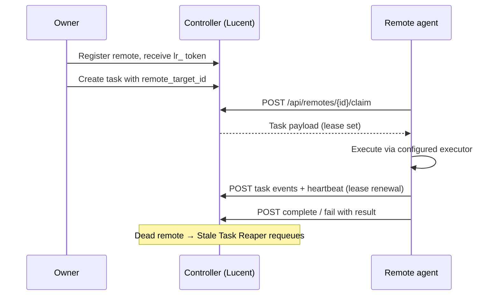

# Remotes (Agent Control Protocol)

A **remote** is a non-local executor that Lucent can target with whole tasks —
another Lucent deployment, a laptop, a build box, or any machine running the
shipped agent client. Remotes are the out-of-process counterpart to
[sandboxes](sandboxes.md): where a sandbox is a container Lucent creates and
fully controls on the local host, a remote is an environment Lucent does not
control and cannot observe except through the protocol.

## Design

The control relationship is **pull-based and outbound-only**:



A remote never opens an inbound port. It initiates every connection, which
means a machine behind NAT or a corporate firewall works identically to one on
the public internet.

### Coordination reuses the daemon model

Each remote registers as a `daemon_instances` row with the id `remote:{uuid}`
on first heartbeat. Because of that:

- lease renewal happens through the existing `heartbeat_instance` path;
- a dead remote's tasks are released by the existing **Stale Task Reaper**
  with no remote-specific logic;
- released tasks keep their `remote_target_id` pin, so they return to the same
  remote when it comes back rather than silently leaking to local dispatch.

### Dispatch rules

- Tasks pinned to a remote are invisible to local dispatch
  (`tasks.remote_target_id IS NULL` in the dispatch predicate).
- A remote only sees tasks pinned to **itself**.
- Stage gates (`sequence_order`, `dependency_policy`, approval status) apply
  unchanged — the remote predicate mirrors the local one deliberately.

## Security model

Remote execution is a trust boundary, so the controls are layered rather than
concentrated in one check.

| Threat | Control |
| --- | --- |
| Stolen token used against other endpoints | Dedicated `lr_` prefix; `remote-agent` scope allowlisted to five routes in `api/deps.py` |
| Token reused against another remote | Key name embeds the remote id; both `deps` and the route handler enforce path-vs-key binding |
| Remote touching tasks it never claimed | `_is_remote_task_actor` requires `tasks.claimed_by == remote:{id}`; request-level mutation rights are explicitly denied to remote keys |
| Privilege escalation via role | Remote identity users have role `daemon`, which grants blanket request mutation. `_can_mutate_request` returns `False` for any `remote-agent` key before the role check |
| Token exposure in transit | Client refuses plain `http://` to non-local hosts unless `--insecure` |
| Credential leakage to the remote | The claim payload strips `sandbox_config`; the remote never receives Lucent credentials |
| Token replay after revoke | Revoking a remote revokes its API key in the same transaction |
| Oversized payloads | Events capped at 64 KiB, results at 1 MiB, truncated with a visible marker |
| Shell injection via task text | Task text is delivered on **stdin**; argv is a fixed operator-configured template and never interpolates task content |

### Authorization

- **Owners** register, rotate, disable, revoke, and requeue remotes.
- **Admins** may read the remote list.
- **Members** cannot see the Remotes tab.
- **Daemon** may target remotes when creating tasks; members may not.
- All web mutations go through the standard CSRF double-submit check.

## Setup

### 1. Register the remote

In **Sandboxes → Remotes**, enter a name and click **Register remote**. The
plaintext token is displayed exactly once — copy it immediately. Only a bcrypt
hash is stored.

Or via API:

```bash
curl -X POST https://lucent.example.com/api/remotes \
  -H "Authorization: Bearer $OWNER_API_KEY" \
  -H 'Content-Type: application/json' \
  -d '{"name":"build-box-01","description":"CI machine"}'
```

Note the returned `id` and `token`.

### 2. Run the agent on that machine

The client is `scripts/lucent_remote_agent.py` — single file, Python 3.9+,
**standard library only**. Copy it to the remote host; nothing to install.

```bash
export LUCENT_CONTROLLER_URL=https://lucent.example.com
export LUCENT_REMOTE_TOKEN=lr_...
export LUCENT_REMOTE_ID=<remote uuid>
export LUCENT_REMOTE_EXECUTOR=command
export LUCENT_REMOTE_COMMAND='["python3","/opt/agent/run_task.py"]'

python3 lucent_remote_agent.py
```

Use `--once` to claim at most one task and exit (useful for cron or smoke
tests). Use `--executor noop` to verify connectivity without running anything.

### Executors

| Executor | Behaviour |
| --- | --- |
| `noop` | Echoes the task back as the result. Connectivity smoke test. |
| `command` | Runs a fixed argv template, passing the rendered task text on stdin. Exit code 0 = success. |
| `shell` | Runs the commands the task itself carries, in a per-task directory. Opt-in. |

The task text includes the title, parent request title, task id, agent type,
priority, and description — enough context to act without a round trip.

#### The `command` executor

`command` is for a host that has one fixed entry point (an agent runner, a build
script). The task description travels on stdin, so it can never become shell
syntax on the remote.

#### The `shell` executor

`shell` is for hosts where Lucent should be able to run arbitrary work. Enable
it deliberately — it executes code chosen by whoever authored the task:

```bash
export LUCENT_REMOTE_EXECUTOR=shell
# optional, defaults to $SHELL then /bin/sh
export LUCENT_REMOTE_SHELL=/bin/zsh
```

The commands come from fenced code blocks in the task description, tagged `sh`,
`bash`, `shell`, `zsh`, or `console`:

    Report this host's identity.

    ```sh
    uname -a
    sw_vers 2>/dev/null || true
    ```

Every recognized block is concatenated in order and run with `bash -c` (or the
configured shell) in a fresh per-task directory. A task with **no** fenced
command block fails with exit code 2 instead of executing the prose — running a
description as a script is never the intent.

Guard rails on `shell`:

- per-task working directory (the cwd), cleaned up afterwards;
- `TMPDIR` points at the task directory so scratch files are cleaned up;
- `HOME` stays the operator's real home, so `git`, `ssh`, and `npm` read the
  configs they expect. The per-task dir is not a sandbox — this executor already
  runs task-authored code — so redirecting `HOME` would only have made commands
  report a throwaway path and broken those tools. Override with
  `LUCENT_REMOTE_HOME` if a dedicated home is wanted;
- the configured task timeout applies (`--task-timeout`, default 3600s);
- exit code and stderr are reported back, so failures are visible rather than
  silent.

A `lucent` executor (where the remote runs the task in its own sandboxes via a
local daemon) fits the same interface and is the natural next step.

## Operations

### Targeting a remote

Set `remote_target_id` when creating a task:

```bash
curl -X POST https://lucent.example.com/api/requests/$REQUEST_ID/tasks \
  -H "Authorization: Bearer $OWNER_API_KEY" \
  -H 'Content-Type: application/json' \
  -d '{"title":"Build release","description":"...","remote_target_id":"<uuid>"}'
```

`remote_target_id` cannot be combined with `sandbox_template_id` or
`sandbox_config`: a remote runs work in its own environment, so a local sandbox
would be silently ignored. This is rejected at authoring time rather than
pretended.

Tasks created by the daemon may also be pinned, which is how autonomous work
can be routed to remote capacity.

### From an agent (MCP)

Agents discover remotes with `list_remotes()` and pin work with
`remote_target_id`, either on `create_task` or inside a `create_request`
`task_plan` entry:

```python
list_remotes()                 # ids, names, status, last_seen_at
create_task(
    request_id="…",
    title="Collect host facts",
    description="Report this machine's OS and disk usage.\n\n```sh\nuname -a\ndf -h\n```",
    remote_target_id="<id from list_remotes>",
)
```

Only `active` remotes are targetable. An unknown, disabled, or revoked id is
rejected at authoring time with a list of usable remotes — never silently
dropped, because a dropped pin means a local daemon claims work that was meant
for another machine.

`remote_target_id` is mutually exclusive with `sandbox_template_id` /
`sandbox_overrides`, and applies to `agent` tasks only (decision and fusion
tasks execute in-process).

The shipped remote agent runs whichever executor its operator configured.

### Winding a remote down

- **Disable** — the remote stops being allowed to claim, but already-pinned
  tasks stay pinned.
- **Requeue tasks** — unpins `pending`/`planned` tasks so local dispatch can
  take them. Claimed/running work is left to the reaper rather than yanked from
  under an active agent.
- **Revoke** — terminal. The agent token is invalidated immediately.

### Recovery

If a remote dies mid-task, its `daemon_instances` row goes stale and the Stale
Task Reaper releases the claim within the normal stale window (default 30
minutes of inactivity). The task returns to `pending` **with its pin intact**,
so it is reclaimed when that remote reconnects, or you can requeue it manually.

## Testing

```bash
PYTHONPATH=src ./.venv/bin/pytest -q -m integration \
  tests/test_remotes_api.py tests/test_remote_claim_flow.py
PYTHONPATH=src ./.venv/bin/pytest -q tests/test_remote_agent_client.py
```

`tests/test_remote_claim_flow.py` covers the invariants that matter: dispatch
exclusion, cross-remote isolation, exclusive claiming under race, lease
renewal, reaper release, and the allowlist negatives.
